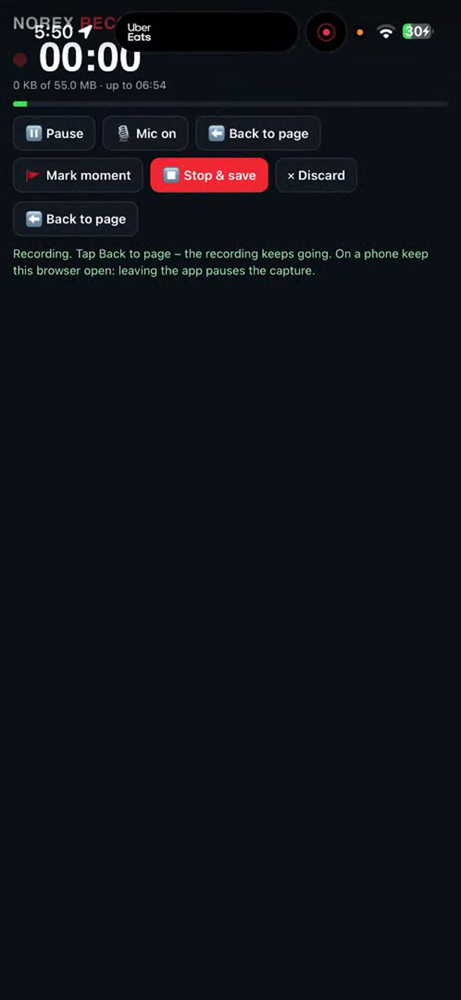
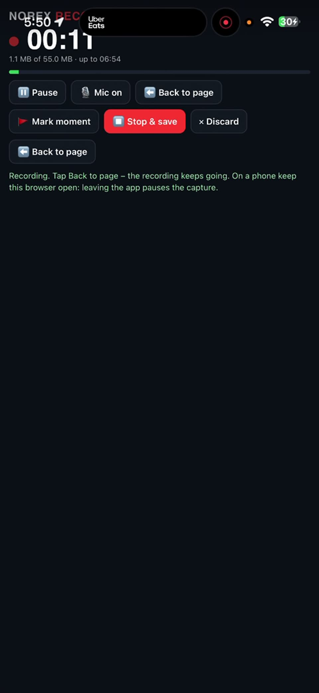
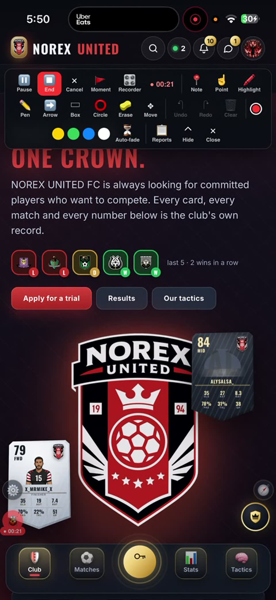
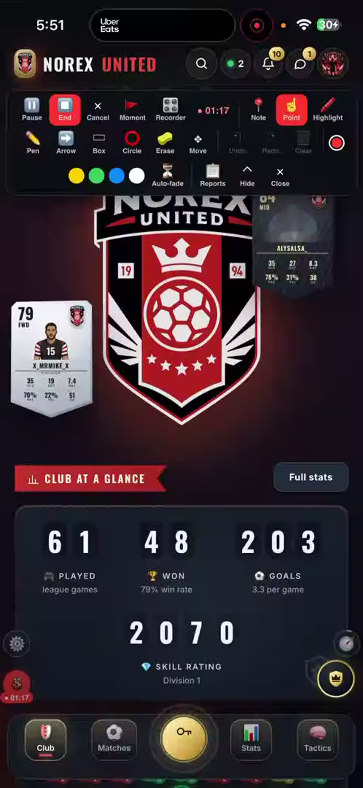
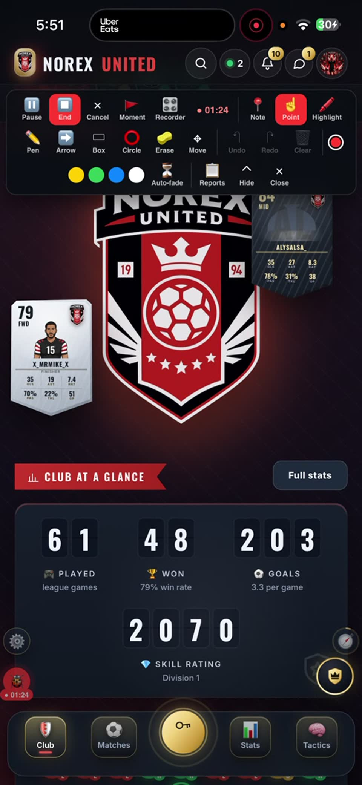
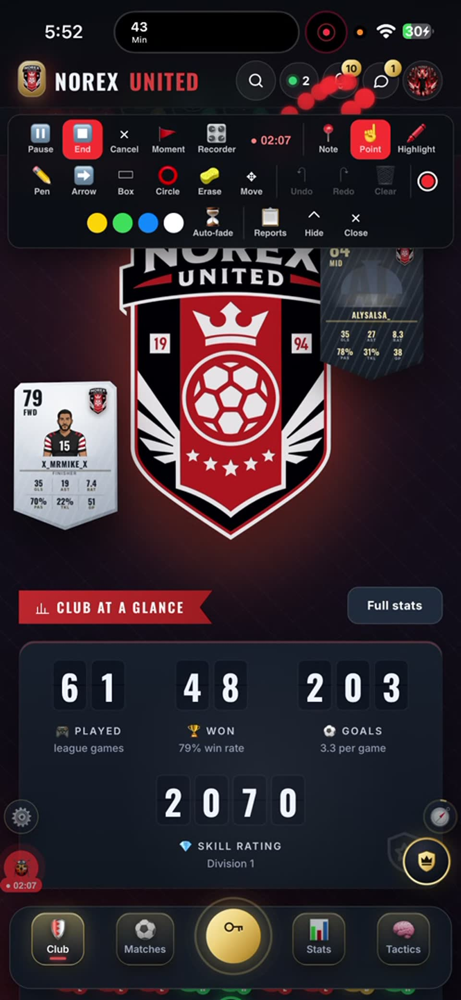
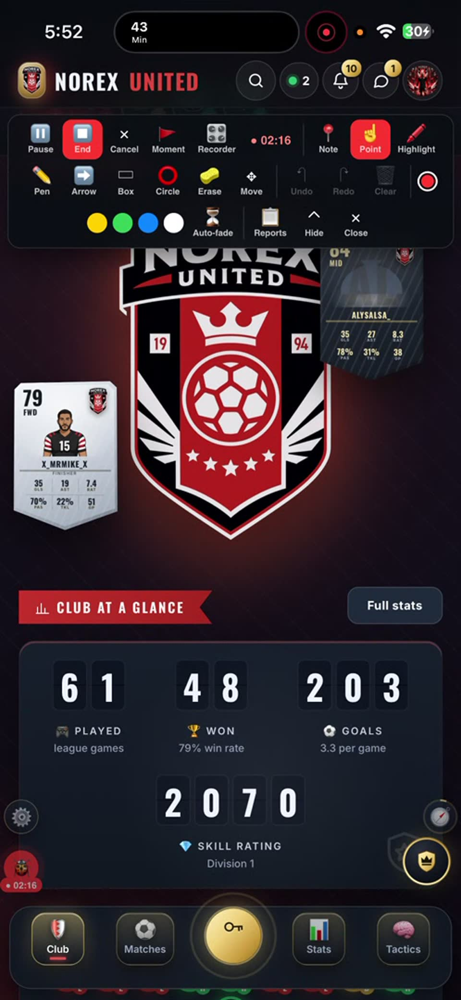
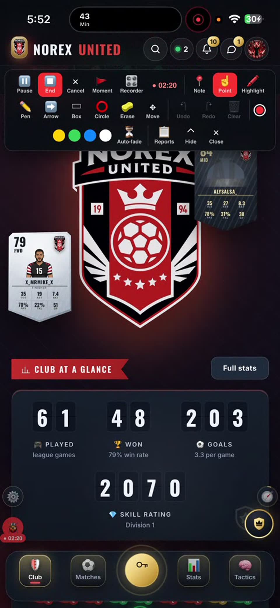

# Report #1 · wrong · open

- **Page:** /
- **Device:** iPhone · iOS 18.7 · Safari 27.0 · 506x1096 @3x · installed app
- **Role:** owner
- **Filed:** 2026-10-16T00:50:23.253Z
- **Id:** imv7qoze6feww:1

## What Mike wrote

🎥 Screen recording · 05:13 · 0 pages · 42.6 MB (norex-bug-imv7qoze6feww-20261015-1750.webm) — “So Trying to figure this out OK so first things first I'm not very it's not very clear to me why these two cards are the only ones that show episode that I believe that when we go promotion effects to be calm From there to be full meaning we have tilt options I think they actually give this they changed their formatting they go in the street standing rather than you know laid standing option That I would like to kind of change this and Good my cards like the top five Most active players and put them beneath the crest they aligned each with its own you know tilt a glowing just in an organized matter and if you need to structure the emblement a bit differently to not look I go ahead and do so as long as we could get you know better look at at first The other thing would be One request didn't go through apparently but I had previously requested These options I didn't ask for the active to b…”

## Recording

05:13 long · 42.6 MB · voice-over on · full video in the workflow artifact “issue-videos” (2026-10-16-imv7qoze6feww-1.webm)

### What was said (captions)

- 00:10 So
- 00:21 Trying to figure this out
- 00:55 OK so first things first I'm not very it's not very clear to me why these two cards are the only ones that show episode that I believe that when we go promotion effects to be calm
- 01:16 From there to be full meaning we have tilt options I think they actually give this they changed their formatting they go in the street standing rather than you know laid standing option
- 01:24 That I would like to kind of change this and
- 01:30 Good my cards like the top five
- 01:53 Most active players and put them beneath the crest they aligned each with its own you know tilt a glowing just in an organized matter and if you need to structure the emblement a bit differently to not look
- 02:02 I go ahead and do so as long as we could get you know better look at at first
- 02:06 The other thing would be
- 02:16 One request didn't go through apparently but I had previously requested
- 02:20 These options
- 02:47 I didn't ask for the active to be outside of the profile picture were used to be that layout the dot the green dot with the with the number should go on the corner right here where I'm pointing it should go on the corner of the profile picture not have its dedicated button
- 03:12 In the same request I had mentioned that these I wanted separate why because I want each one of these to take you to its own dedicated tab no that does not mean that is they're gonna take you like the do right now
- 03:34 In the hub were located now I want these to be exclusively each one have their own separate tabs with nothing else on it so clicking on one will take you to the messages and you will be able to see the messages there
- 03:39 The notifications actually
- 04:06 Don't make it it's home tab I'm just making a drop-down it's own exclusive drop-down not different to the one where you click on profile picture because right now for example the active ones the green dot and the profile picture give you the same menu when it should if we really wanna keep it that way outside it
- 04:17 Just keep active and we dropped down we're in that case that would be excluded from the profile picture dropped down
- 04:27 Have dedicated on the new one and within that you could search four members see their last activity
- 04:36 If you click on one of those names it's gonna take you not to their profile picture
- 05:03 Molly could take you to the profile picture I guess it depends if you click on your name it would take you to the messages tab not the messages dropped down but directly to the messaging that person and if you click on the profile picture it's gonna take you to the profile of that user
- 05:06 Open snap
- 05:10 The big image

### Frames

**00:00** start

**00:10** 💬 So

**00:21** 💬 Trying to figure this out

**00:55** 💬 OK so first things first I'm not very it's not very clear to me why these two cards are the only ones that show episode that I believe that when we go promotion effects to be calm

**01:16** 💬 From there to be full meaning we have tilt options I think they actually give this they changed their formatting they go in the street standing rather than you know laid standing option

**01:24** 💬 That I would like to kind of change this and

**01:30** 💬 Good my cards like the top five

**01:53** 💬 Most active players and put them beneath the crest they aligned each with its own you know tilt a glowing just in an organized matter and if you need to structure the emblement a bit differently to not look

**02:02** 💬 I go ahead and do so as long as we could get you know better look at at first

**02:06** 💬 The other thing would be

**02:16** 💬 One request didn't go through apparently but I had previously requested

**02:20** 💬 These options

