# Report #2 · polish · open

- **Page:** /
- **Device:** iPhone · iOS 18.7 · Safari 27.0 · 506x1096 @3x · installed app
- **Role:** owner
- **Filed:** 2026-10-16T00:56:48.682Z
- **Id:** imv7qoze6feww:2

## What Mike wrote

🎥 Screen recording · 06:30 · 0 pages · 52.6 MB (norex-bug-imv7qoze6feww-20261015-1756.webm) — “OK so for starters please fix this It's basically behind the top iPhone bar just drag it down So now I'm going into the page here is where I want you to So for example here I think it already fixed itself but I'll give you an example when I click on motion effects I'll say have it casual OK save the settings That actually shouldn't be the lucky should be getting if you see their kind of tilted but that wasn't really what I was gonna check Straight here it's working fine when it's casual but it breaks as soon as we change it to tilt the top remained in the tilt function until you actually click on the for that back Check that but most importantly if I go once again to the to the motion flex in change it back to full Things should start acting weirdly the meet the squad with this This is very broken super slow and it's probably making phones slow too so we need to fix this ASAP it needs to…”

## Recording

06:29 long · 52.6 MB · voice-over on · full video in the workflow artifact “issue-videos” (2026-10-16-imv7qoze6feww-2.webm)

### What was said (captions)

- 00:06 OK so for starters please fix this
- 00:16 It's basically behind the top iPhone bar just drag it down
- 00:25 So now I'm going into the page here is where I want you to
- 00:38 So for example here I think it already fixed itself but I'll give you an example when I click on motion effects I'll say have it casual
- 00:43 OK save the settings
- 00:58 That actually shouldn't be the lucky should be getting if you see their kind of tilted but that wasn't really what I was gonna check
- 01:19 Straight here it's working fine when it's casual but it breaks as soon as we change it to tilt the top remained in the tilt function until you actually click on the for that back
- 01:35 Check that but most importantly if I go once again to the to the motion flex in change it back to full
- 01:47 Things should start acting weirdly the meet the squad with this
- 02:20 This is very broken super slow and it's probably making phones slow too so we need to fix this ASAP it needs to be the same function that these have basically you see you see that they can't move I think we could be more smooth with the animation of the tilt for the card specifically increase the sensitivity
- 02:27 It's not sideways right now so this something is going on
- 02:51 In addition to that when you first load the page after it changes were made it's always gonna have that side look regardless of your own casual or not so make it make this work from the very start and remember the default motion and effects that every user supposed to have
- 02:58 Puna every update right but let's say that
- 03:14 First time they set up the app it's always gonna be on no matter what it's always gonna be on but if they make their own changes and either select custom
- 03:17 Casual
- 03:36 Process throughout changes made to the site afterwards if it's the same app it should persist meaning it shouldn't prompt them those options once again and it shouldn't prompt them the drivers group option or the microphone option or any other permission they gave
- 03:51 Please include that we need to fix that that's very important and from this page that's so far that's it oh actually no
- 03:54 These right here
- 04:00 If I click on them nothing happens
- 04:11 Nothing at all happens so I'm clicking on them right now I like I'll leave point I'm quick enough condom now nothing's happening
- 04:43 We have the hub all that this is not what I had previously asked for I mean I like the club the matches in that cold background it does look premium but I think it doesn't fit well with the bottom card right
- 05:03 Sustaining them together and what I mean by that just pointing at it directly would be this part in the middle one doesn't fit well with these show either way adapt these to the background or adapt the background to the parts
- 05:13 Let's align them because I noticed that they're a bit closer to the top and they are to the bottom and that
- 05:40 Is not the one I had asked for the original app before this redesign that's but type I want which is more of a dis iconic straightforward just a straight key that doesn't go fit well with a theme of the page itself it should be a symbol that's quite animated
- 06:14 It should display a glow effect with glitter effect that goes towards the top like kind of a little bit and should be reactive with the tool defect but also should be reactive when clicked one clicked it's gonna make expand the circle a little bit like bounce and the key is gonna make animation to go up and lock the gold locker

### Frames

**00:00** start

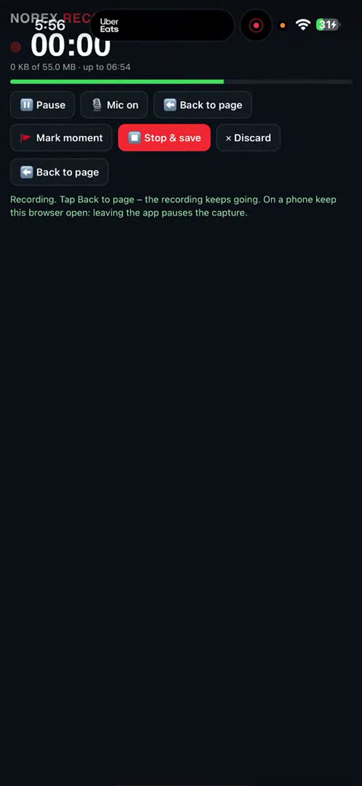

**00:06** 💬 OK so for starters please fix this

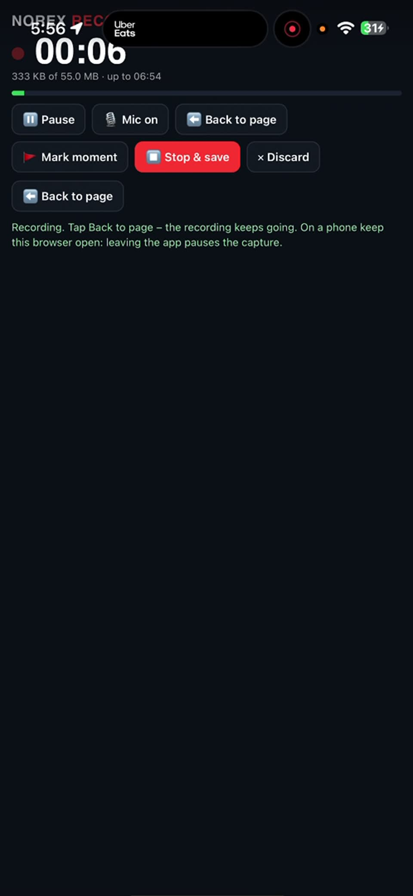

**00:16** 💬 It's basically behind the top iPhone bar just drag it down

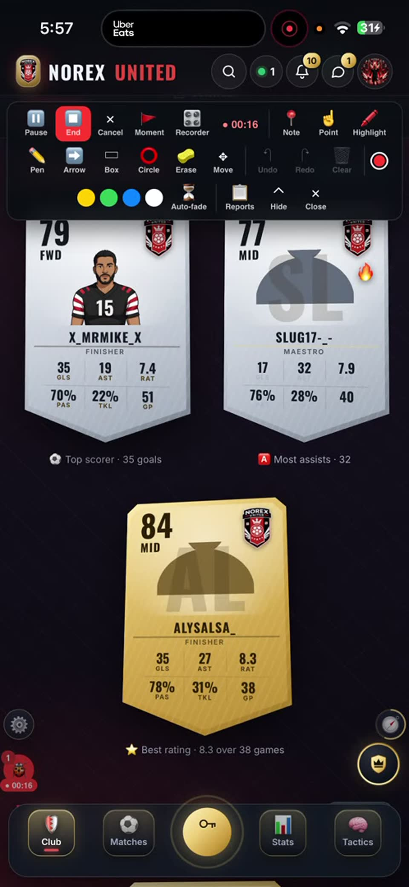

**00:25** 💬 So now I'm going into the page here is where I want you to

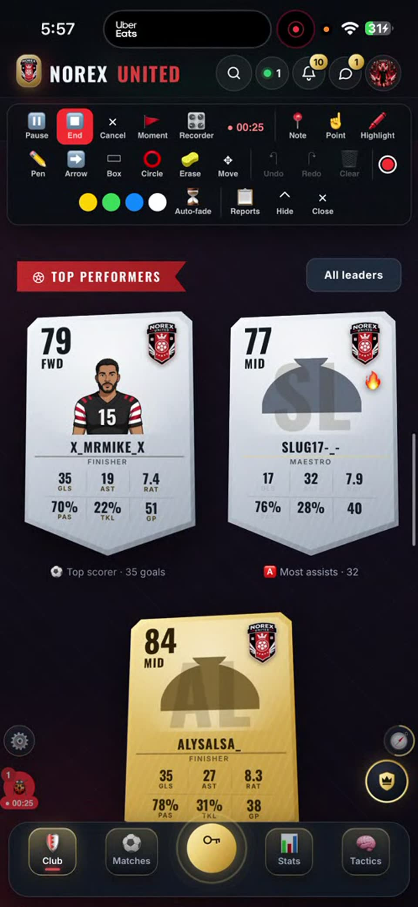

**00:38** 💬 So for example here I think it already fixed itself but I'll give you an example when I click on motion effects I'll say have it casual

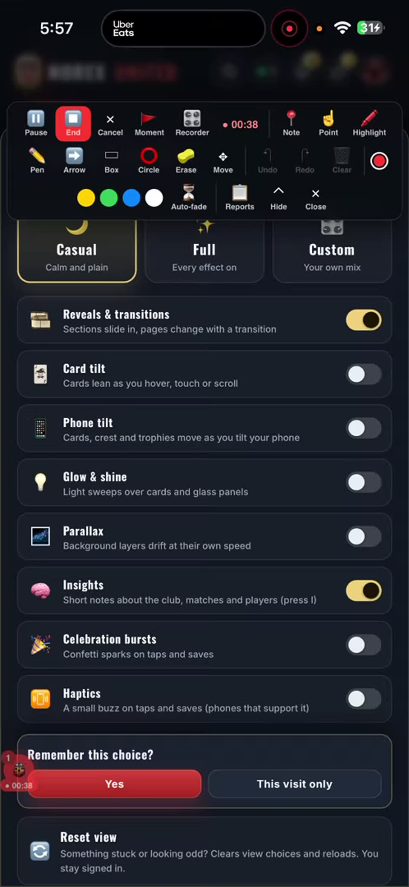

**00:43** 💬 OK save the settings

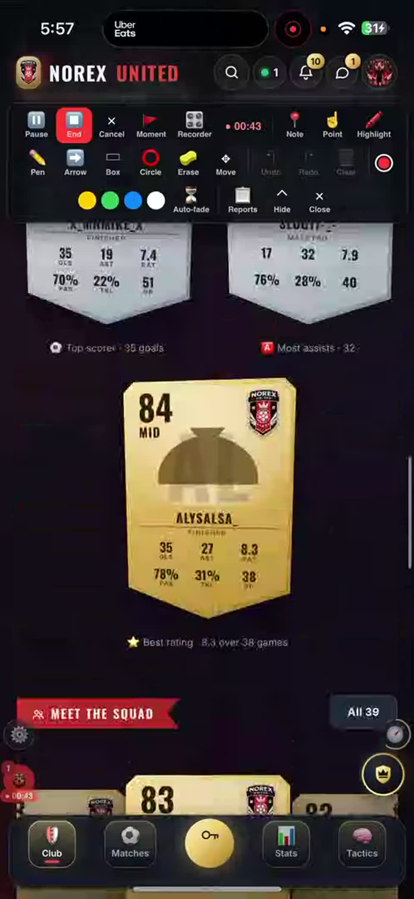

**00:58** 💬 That actually shouldn't be the lucky should be getting if you see their kind of tilted but that wasn't really what I was gonna check

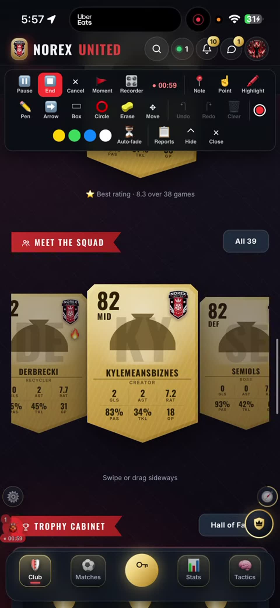

**01:19** 💬 Straight here it's working fine when it's casual but it breaks as soon as we change it to tilt the top remained in the tilt function until you actually click on the for that back

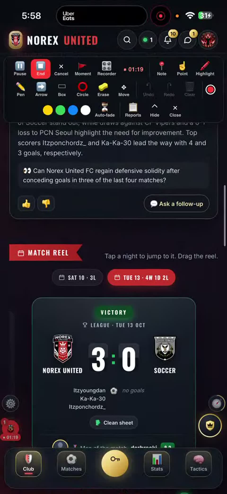

**01:35** 💬 Check that but most importantly if I go once again to the to the motion flex in change it back to full

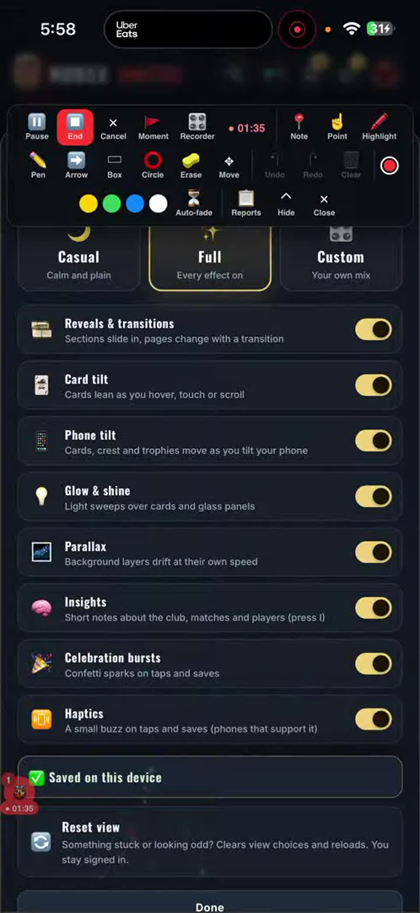

**01:47** 💬 Things should start acting weirdly the meet the squad with this

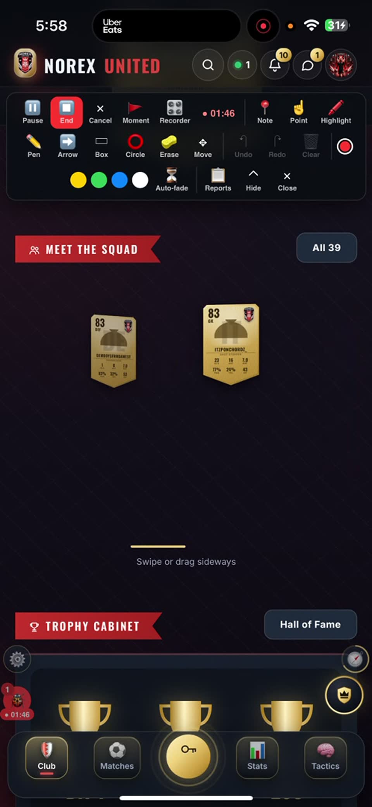

**02:20** 💬 This is very broken super slow and it's probably making phones slow too so we need to fix this ASAP it needs to be the same function that these have basically you see you see that they can't move I think we could be more smooth with the animation of the tilt for the card specifically increase the sensitivity

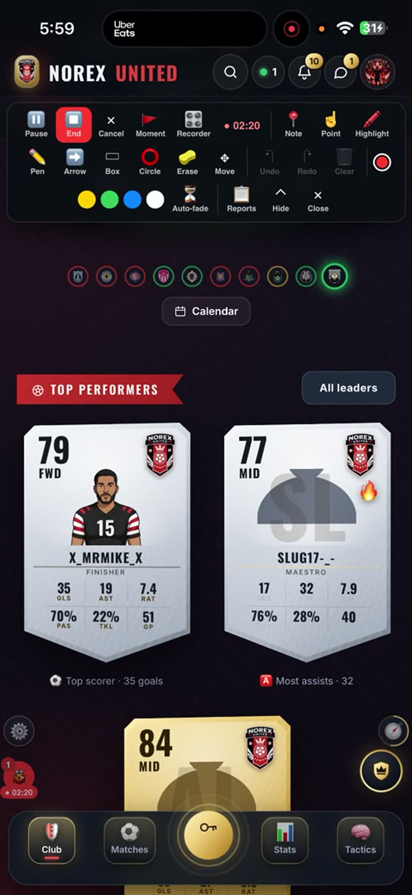

**02:27** 💬 It's not sideways right now so this something is going on

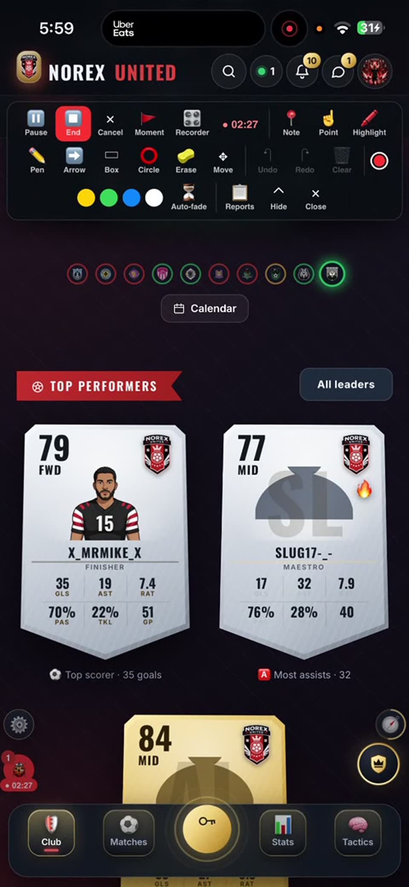

